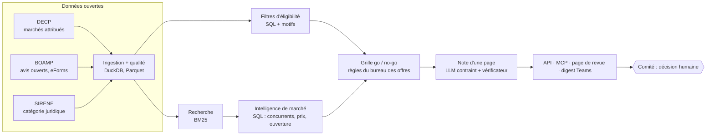

# Avant-Offre

Copilote go / no-go pour le bureau des appels d'offres d'une entreprise qui répond aux marchés
publics français. Avant-Offre classe les avis de la semaine selon le profil de l'entreprise,
prépare pour chaque avis une note d'une page (contrats comparables, concurrents probables,
ouverture du marché, fourchette de prix, grille de décision) et répond aux questions ponctuelles
via un agent. La décision reste au comité.

Projet de portfolio (AI Engineer / Forward Deployed Engineer). Le code, le journal de décisions
et les rapports d'évaluation sont faits pour être relus.

> **État actuel.** Tout le système est écrit et testé (tests automatisés, CI verte). Les données
> réelles sont ingérées sur le périmètre échantillon (DECP du 15/10/2026, avis BOAMP ouverts du
> 16/10/2026, API SIRENE) et décrites dans `docs/DATA_QUALITY.md`. Les backtests sans modèle
> ont tourné (appariement CPV / BM25 / embeddings / hybride / reranker, concurrents, prix : voir
> « Résultats mesurés »). Reste à mesurer la fidélité des notes LLM (clé d'API requise). Aucun
> chiffre n'a été estimé à la place d'un run.

## Le besoin

Les grandes entreprises qui vendent au secteur public ont un bureau des offres. Chaque semaine,
il reçoit des alertes et doit décider, souvent en comité go / no-go, quels avis méritent les
jours de travail qu'une réponse coûte. Les alertes sont un problème résolu ; la décision qui suit
ne l'est pas : elle dépend de l'adéquation, des références, des sortants, des niveaux de prix et
des délais, rassemblés à la main.

Ordre de grandeur : 223 383 marchés publics pour 233,3 Md€ ont été recensés en France en 2024
(OECP, publication de mars 2026) ; les PME en ont remporté 60 % en nombre mais 25 % en valeur.

Utilisateurs visés (hypothèses construites à partir d'informations publiques, sans entretien) :
le **responsable des offres**, et le **comité go / no-go** (direction commerciale, delivery,
finance). Le besoin : « chaque lundi, dites-moi quels avis regarder et, pour chacun, ce dont le
comité a besoin pour décider en quelques minutes, avec des sources vérifiables ».



## Ce que j'ai observé

Constats tirés des fichiers réels ; chaque point renvoie à `docs/DATA_QUALITY.md` (F-001 à
F-006), dont les volumes et les taux sont générés par `make quality`.

- **Les DECP sont déjà enrichies avec SIRENE** (catégorie PME / ETI / GE, code NAF, département du
  titulaire), mais **pas la catégorie juridique** : détecter les entrepreneurs individuels (des
  personnes physiques) demande toujours l'API SIRENE.
- **Les énumérations publiées ne sont pas celles du fichier** : le type de lieu d'exécution
  arrive sous une vingtaine de graphies (`Code postal`, `CODE POSTAL`, `Code departement`…),
  `nature` mélange majuscules et marchés subséquents, et `idAccordCadre` pointe aussi vers la
  ligne elle-même. Les normaliseurs sont testés sur ces valeurs réelles.
- **Une grande part des avis BOAMP n'est pas en eForms** mais dans les formats nationaux
  (`FNSimple`, `MAPA`) : sans un second analyseur, ces avis n'avaient ni CPV, ni date limite, ni
  durée. Dans les eForms, le SIRET de l'acheteur est une référence vers une autre balise, et la
  première durée trouvée pouvait être la validité des offres, pas celle du marché.
- **Les critères d'attribution sont surtout dans le règlement de la consultation**, pas dans
  l'avis : un fait « manquant » est le plus souvent une vraie absence, que ni l'analyseur ni le
  LLM ne peuvent combler.
- **Les titulaires non liés n'ont pas de nom** dans le fichier (le producteur le remplit depuis
  SIRENE) : le rapprochement approché n'a rien à comparer, ils restent non liés plutôt que
  devinés.
- **Un SIREN d'entrepreneur individuel suffit à retrouver son nom** : il est remplacé par un
  identifiant opaque dans toutes les sorties (rapports, API, MCP, démo), règle testée.
- **Les accords-cadres** portent un montant plafond, pas une dépense : ils sont exclus des
  statistiques de prix, comme les montants signalés `aberrant`. Les DECP ne couvrent que les
  marchés au-dessus de 40 000 € HT : une entreprise qui n'a gagné que des petits marchés y paraît
  nouvelle.

## Les décisions

Règle générale (`docs/DECISIONS.md`) : l'IA sert à comprendre le texte libre et à rédiger pour un
lecteur humain ; tout ce qui doit être exact, auditable ou appartient au métier reste
déterministe. Sur 13 étapes, 2 utilisent l'IA comme outil principal, 2 en repli, et la décision
reste humaine. L'appariement par embeddings a été construit et mesuré, puis écarté : il ne bat
pas BM25.

| Étape | Approche | Pourquoi |
| --- | --- | --- |
| Collecte, dédoublonnage, filtres d'éligibilité | Sans IA | Données structurées ; exclusions exactes et motivées |
| Liaison titulaires ↔ entreprises | IA en repli | SIRET, puis SIREN / TVA, puis nom approché ; embeddings seulement pour le reste, signalés |
| Extraction des faits de l'avis | IA en repli | Champs eForms d'abord ; le LLM ne lit que du texte, jamais un montant ou une date, avec citation vérifiée mot pour mot |
| Appariement avis ↔ profil | Sans IA (IA testée, écartée) | Embeddings, hybride et reranker mesurés sur le backtest : aucun ne bat BM25, qui est livré seul |
| Intelligence de marché, grille go / no-go | Sans IA | Agrégations SQL traçables ; grille éditée par le bureau des offres |
| Note d'une page | IA | Le LLM ne reçoit que des faits calculés ; chaque chiffre est vérifié, sinon modèle déterministe |
| Questions ponctuelles | IA (modèle du client) | Agent MCP qui appelle les mêmes outils SQL, jamais sa mémoire |
| Diffusion hebdomadaire | Low-code | Flux Power Automate déjà gouverné par l'IT |
| Décision | Humain | Le comité porte la décision et son risque |

Ce qui n'a **pas** été construit, volontairement : un chatbot comme interface principale, un
modèle de probabilité de gain (les offres perdantes ne sont pas publiques), la rédaction du
mémoire technique, un RAG sur tous les avis. Chaque décision de construction est datée dans
`docs/DECISIONS.md`, avec ses alternatives et la condition qui la ferait réviser.

## Résultats mesurés

Backtests sur les attributions réelles (périmètre échantillon : 10 départements, CPV 45, 72, 79,
90). Profils, index et statistiques construits uniquement avec les marchés notifiés avant le
1er janvier 2025 (test `tests/test_leakage.py`), testés sur les attributions de 2025. Chiffres
copiés de `reports/SUMMARY.md` (généré par `make eval-sample`) ; intervalles de confiance à 95 %
par bootstrap dans chaque rapport. Deux exécutions successives donnent des rapports identiques.

**Appariement** (`reports/matching_baselines.md`, 382 entreprises de test) : part des marchés
réellement gagnés en 2025 retrouvés dans les 20 premiers avis proposés (Recall@20).

| Méthode | Recall@20 |
| --- | --- |
| Alerte CPV classique (avis du même groupe CPV, les plus récents d'abord) | 0,021 |
| Alerte CPV classée par fréquence des codes gagnés (référence la plus forte sans IA) | 0,139 |
| BM25, profil moyen de l'entreprise | **0,270** |

Écart BM25 − meilleure alerte CPV, apparié par entreprise : **+0,131 [0,097 ; 0,167]**.

**Embeddings, hybride, reranker** (`reports/matching.md`, mêmes entreprises de test) : l'IA ne
bat pas BM25 ici, elle n'est donc pas livrée.

| Méthode | Recall@20 |
| --- | --- |
| BM25, profil moyen (livré) | **0,270** |
| Hybride BM25 + embeddings `multilingual-e5-small` (RRF) | 0,258 |
| Embeddings seuls | 0,209 |
| Hybride + reranker `bge-reranker-v2-m3` (100 entreprises, ≈ 23 s par entreprise sur CPU) | 0,237 |

Écart hybride − BM25 : −0,012 [−0,034 ; 0,009] ; reranker − hybride : −0,016 [−0,064 ; 0,034].
La règle fixée avant les données (`docs/DECISIONS.md`, étape 6) s'applique : BM25 reste seul.

**Concurrents probables** (`reports/competitors.md`, 5 497 couples attribution–titulaire) : le
vrai titulaire figure parmi les 10 concurrents prédits dans 20 % des cas, 44 % quand il a déjà
travaillé pour cet acheteur, 13 % sinon. Les primo-titulaires (8 % des cas) ne peuvent pas être
nommés à partir de l'historique public : la note donne la part de primo-titulaires. Sa
calibration, vérifiée par déciles, suit la diagonale au-dessus de 5 % ; en dessous, elle sous-estime
les marchés les plus fermés (environ 4 % de primo-titulaires observés).

**Fourchette de prix** (`reports/prices.md`, 3 430 attributions) : la fourchette P25–P75 couvre
48 % des montants réels (cible ≈ 50 %), P10–P90 en couvre 75 % (cible ≈ 80 %). En informatique
(division 72), elle n'en couvre que 35 % et 50 % : la fourchette n'est plus affichée pour ce
domaine et le critère de prix de la grille y reste « non évalué », avec la raison.

**Modèles d'embeddings** (`reports/embed_bench.md`, échantillon de réglage, 101 entreprises) :
seuls, les trois modèles testés font moins bien que BM25 sur les mêmes entreprises.

| Modèle | Recall@20 | s / 1 000 titres (CPU) |
| --- | --- | --- |
| `multilingual-e5-small` (retenu) | 0,203 | 8,8 |
| `multilingual-e5-base` | 0,202 | 30,8 |
| `bge-m3` | 0,209 | 98,1 |
| Référence : BM25, profil moyen | 0,281 | — |

Pas encore mesurée : la fidélité des notes LLM (`reports/brief_faithfulness.md`, clé d'API
requise).

## Limites

- **Aucun test avec de vrais utilisateurs.** La validation porte uniquement sur les résultats
  d'attribution publics. L'interface enregistre les retours (pertinent / non pertinent, go /
  no-go) pour qu'un pilote puisse commencer.
- **Gagner ≠ être pertinent** : les DECP enregistrent les gagnants, pas les offres perdues ; le
  rappel sur les gains est une borne basse et la précision n'est pas annoncée.
- **L'objet du marché attribué remplace le texte de l'avis** dans le backtest.
- **Seuil de 40 000 € HT** : les petites références sont invisibles.
- **Pondérations de la grille** : valeurs par défaut illustratives, à fixer par le bureau des
  offres (`config/scorecard.yaml`).
- Les nouveaux entrants sans historique public ne peuvent pas être nommés : la note donne la
  part de primo-titulaires sur les contrats comparables.

## Ce que ça deviendrait en production

Hébergement (Azure Container Apps, jobs hebdomadaires, Key Vault, SSO devant la page de revue),
sécurité, coûts hebdomadaires, supervision et points à faire valider par l'IT, la sécurité et le
DPO : `docs/HANDOFF.md`. Démonstration de 3 minutes : `docs/DEMO_SCRIPT.md`.

## Lancer le projet

Prérequis : Python 3.12 et [uv](https://docs.astral.sh/uv/), Node 22 pour la page de revue.
Accès réseau aux hôtes listés dans `reports/check_sources.md`.

```bash
cp .env.example .env            # ANTHROPIC_API_KEY (facultatif), AVANT_OFFRE_API_KEY
make setup                      # dépendances (sans le runtime des modèles)
make lint test                  # ruff, mypy strict, pytest
make check-sources              # accessibilité des sources de données

make data-sample quality        # DECP + SIRENE + BOAMP (périmètre réduit), docs/DATA_QUALITY.md
make index-sample               # index BM25 des marchés attribués
make eval-sample                # tous les backtests -> reports/
make setup-full                 # + embeddings et reranker (torch, sentence-transformers)

make serve                      # API FastAPI sur :8000 (documentation OpenAPI sur /docs)
make web-install web            # page de revue sur :5173
make mcp                        # serveur MCP (stdio) pour Claude Desktop / Claude Code
uv run avant-offre match --siret <SIRET>          # classement en ligne de commande
uv run avant-offre brief --notice <id> --siret <SIRET>
```

Sans téléchargement : `uv run avant-offre demo-load demo/` construit la base depuis un instantané
pseudonymisé (à produire avec `avant-offre demo-export` sur une base réelle).

Arborescence : `src/avant_offre/` (ingest, transform, search, intel, score, brief, agent, api,
digest, llm, eval), `config/` (réglages, grille, modèles), `docs/`, `reports/`, `web/`, `tests/`.

## Sources et licences

| Source | Usage | Licence |
| --- | --- | --- |
| DECP consolidées (data.gouv.fr), traitement de Colin Maudry | marchés attribués | Licence Ouverte 2.0 |
| BOAMP (DILA, API Opendatasoft) | avis ouverts | Licence Ouverte 2.0 |
| Base SIRENE (INSEE) et API Recherche d'entreprises | catégorie juridique | Licence Ouverte 2.0 |
| CPV 2008 (Règlement (CE) n° 213/2008) | hiérarchie des codes | — |

Les données ouvertes contenant des données personnelles restent soumises au droit de la
protection des données : les entrepreneurs individuels sont pseudonymisés dans toutes les
sorties (« Entreprise individuelle #… »), et un titulaire dont le statut est inconnu l'est aussi
par défaut.
