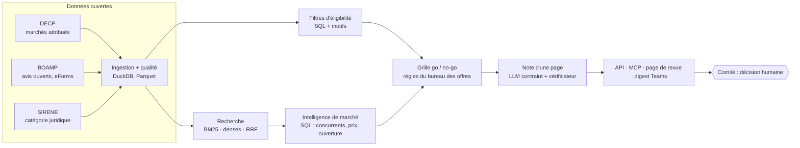

# Avant-Offre

Copilote go / no-go pour le bureau des appels d'offres d'une entreprise qui répond aux marchés
publics français. Avant-Offre classe les avis de la semaine selon le profil de l'entreprise,
prépare pour chaque avis une note d'une page (contrats comparables, concurrents probables,
ouverture du marché, fourchette de prix, grille de décision) et répond aux questions ponctuelles
via un agent. La décision reste au comité.

Projet de portfolio (AI Engineer / Forward Deployed Engineer). Le code, le journal de décisions
et les rapports d'évaluation sont faits pour être relus.

> **État actuel.** Tout le système est écrit et testé (tests automatisés, CI verte), mais **aucun chiffre
> mesuré sur les données réelles n'est encore publié** : depuis l'environnement de développement,
> les hôtes de données (data.gouv.fr, BOAMP, API SIRENE, Hugging Face) étaient bloqués par la
> politique réseau (`reports/check_sources.md`). Les rapports seront produits par
> `make data-sample quality eval-sample` dès que ces hôtes sont accessibles. Aucun résultat n'a
> été estimé ou inventé à leur place.

## Le besoin

Les grandes entreprises qui vendent au secteur public ont un bureau des offres. Chaque semaine,
il reçoit des alertes et doit décider, souvent en comité go / no-go, quels avis méritent les
jours de travail qu'une réponse coûte. Les alertes sont un problème résolu ; la décision qui suit
ne l'est pas : elle dépend de l'adéquation, des références, des sortants, des niveaux de prix et
des délais, rassemblés à la main.

Ordre de grandeur : 223 383 marchés publics pour 233,3 Md€ ont été recensés en France en 2024
(OECP, publication de mars 2026) ; les PME en ont remporté 60 % en nombre mais 25 % en valeur.

Utilisateurs visés (hypothèses construites à partir d'informations publiques, sans entretien) :
le **responsable des offres**, et le **comité go / no-go** (direction commerciale, delivery,
finance). Le besoin : « chaque lundi, dites-moi quels avis regarder et, pour chacun, ce dont le
comité a besoin pour décider en quelques minutes, avec des sources vérifiables ».



## Ce que j'ai observé

Constats issus du schéma publié par le producteur des DECP consolidées
(`ColinMaudry/decp-processing`, `reference/schema_base.json`) ; ils seront confrontés au fichier
réel au premier téléchargement, qui échoue bruyamment si une colonne attendue manque.
Détail : `docs/DATA_QUALITY.md` (F-001, F-002).

- **Les DECP sont déjà enrichies avec SIRENE** (catégorie PME / ETI / GE, code NAF, département du
  titulaire) : inutile de retélécharger ces champs.
- **La catégorie juridique n'est pas publiée** : détecter les entrepreneurs individuels (des
  personnes physiques) demande toujours SIRENE. Le producteur masque les personnes
  non diffusibles, mais pas les entrepreneurs individuels diffusibles.
- **Les accords-cadres** portent un montant plafond, pas une dépense : ils sont identifiés par
  `techniques` et exclus des statistiques de prix, comme les montants signalés `aberrant`.
- **Le lieu d'exécution** arrive sous 7 formats (code postal, commune, arrondissement, canton
  avec une espace parasite dans l'énumération, département, région, pays).
- **Les seuils** : les DECP ne couvrent que les marchés au-dessus de 40 000 € HT ; une entreprise
  qui n'a gagné que des petits marchés y paraît nouvelle.

Les volumes, taux de liaison, couverture des champs et doublons seront générés par
`make quality` dans `docs/DATA_QUALITY.md`.

## Les décisions

Règle générale (`docs/DECISIONS.md`) : l'IA sert à comprendre le texte libre et à rédiger pour un
lecteur humain ; tout ce qui doit être exact, auditable ou appartient au métier reste
déterministe. Sur 13 étapes, 3 utilisent l'IA comme outil principal, 2 en repli, et la décision
reste humaine.

| Étape | Approche | Pourquoi |
| --- | --- | --- |
| Collecte, dédoublonnage, filtres d'éligibilité | Sans IA | Données structurées ; exclusions exactes et motivées |
| Liaison titulaires ↔ entreprises | IA en repli | SIRET, puis SIREN / TVA, puis nom approché ; embeddings seulement pour le reste, signalés |
| Extraction des faits de l'avis | IA en repli | Champs eForms d'abord ; le LLM ne lit que du texte, jamais un montant ou une date, avec citation vérifiée mot pour mot |
| Appariement avis ↔ profil | IA | Les acheteurs décrivent le même besoin avec d'autres mots ; BM25 reste le défaut tant que l'hybride ne le bat pas sur le backtest |
| Intelligence de marché, grille go / no-go | Sans IA | Agrégations SQL traçables ; grille éditée par le bureau des offres |
| Note d'une page | IA | Le LLM ne reçoit que des faits calculés ; chaque chiffre est vérifié, sinon modèle déterministe |
| Questions ponctuelles | IA (modèle du client) | Agent MCP qui appelle les mêmes outils SQL, jamais sa mémoire |
| Diffusion hebdomadaire | Low-code | Flux Power Automate déjà gouverné par l'IT |
| Décision | Humain | Le comité porte la décision et son risque |

Ce qui n'a **pas** été construit, volontairement : un chatbot comme interface principale, un
modèle de probabilité de gain (les offres perdantes ne sont pas publiques), la rédaction du
mémoire technique, un RAG sur tous les avis. Chaque décision de construction est datée dans
`docs/DECISIONS.md`, avec ses alternatives et la condition qui la ferait réviser.

## Résultats mesurés

**Aucun pour l'instant** (voir l'état actuel en haut de page). Les backtests sont écrits, testés
et lancés par `make eval-sample` ; ils comparent sur les attributions réelles :

| Rapport | Question |
| --- | --- |
| `reports/matching.md` | L'hybride (BM25 + denses, RRF, reranker) bat-il les alertes CPV et BM25 en Recall@20, avec un intervalle de confiance au-dessus de 0 ? |
| `reports/embed_bench.md` | Quel modèle d'embeddings donne la meilleure qualité pour son coût ? |
| `reports/competitors.md` | Le vrai titulaire figure-t-il parmi les 5 / 10 concurrents prédits, séparément pour les titulaires connus et les primo-titulaires ? |
| `reports/prices.md` | La fourchette P25–P75 couvre-t-elle ~50 % des montants réels ? |
| `reports/brief_faithfulness.md` | Quelle part des notes LLM passe le vérificateur sans retrait ? |
| `reports/SUMMARY.md` | Synthèse et décisions déclenchées |

Protocole : profils et index construits uniquement avec les marchés notifiés avant la date de
coupure (test `tests/test_leakage.py`), entreprises réparties 20 % réglage / 80 % test par hachage
du SIREN, tous les choix faits sur le réglage, intervalles de confiance par bootstrap.

## Limites

- **Aucun test avec de vrais utilisateurs.** La validation porte uniquement sur les résultats
  d'attribution publics. L'interface enregistre les retours (pertinent / non pertinent, go /
  no-go) pour qu'un pilote puisse commencer.
- **Gagner ≠ être pertinent** : les DECP enregistrent les gagnants, pas les offres perdues ; le
  rappel sur les gains est une borne basse et la précision n'est pas annoncée.
- **L'objet du marché attribué remplace le texte de l'avis** dans le backtest.
- **Seuil de 40 000 € HT** : les petites références sont invisibles.
- **Pondérations de la grille** : valeurs par défaut illustratives, à fixer par le bureau des
  offres (`config/scorecard.yaml`).
- Les nouveaux entrants sans historique public ne peuvent pas être nommés : la note donne la
  part de primo-titulaires sur les contrats comparables.

## Ce que ça deviendrait en production

Hébergement (Azure Container Apps, jobs hebdomadaires, Key Vault, SSO devant la page de revue),
sécurité, coûts hebdomadaires, supervision et points à faire valider par l'IT, la sécurité et le
DPO : `docs/HANDOFF.md`. Démonstration de 3 minutes : `docs/DEMO_SCRIPT.md`.

## Lancer le projet

Prérequis : Python 3.12 et [uv](https://docs.astral.sh/uv/), Node 22 pour la page de revue.
Accès réseau aux hôtes listés dans `reports/check_sources.md`.

```bash
cp .env.example .env            # ANTHROPIC_API_KEY (facultatif), AVANT_OFFRE_API_KEY
make setup                      # dépendances (sans le runtime des modèles)
make lint test                  # ruff, mypy strict, pytest
make check-sources              # accessibilité des sources de données

make data-sample quality        # DECP + SIRENE + BOAMP (périmètre réduit), docs/DATA_QUALITY.md
make index-sample               # index BM25 des marchés attribués
make eval-sample                # tous les backtests -> reports/
make setup-full                 # + embeddings et reranker (torch, sentence-transformers)

make serve                      # API FastAPI sur :8000 (documentation OpenAPI sur /docs)
make web-install web            # page de revue sur :5173
make mcp                        # serveur MCP (stdio) pour Claude Desktop / Claude Code
uv run avant-offre match --siret <SIRET>          # classement en ligne de commande
uv run avant-offre brief --notice <id> --siret <SIRET>
```

Sans téléchargement : `uv run avant-offre demo-load demo/` construit la base depuis un instantané
pseudonymisé (à produire avec `avant-offre demo-export` sur une base réelle).

Arborescence : `src/avant_offre/` (ingest, transform, search, intel, score, brief, agent, api,
digest, llm, eval), `config/` (réglages, grille, modèles), `docs/`, `reports/`, `web/`, `tests/`.

## Sources et licences

| Source | Usage | Licence |
| --- | --- | --- |
| DECP consolidées (data.gouv.fr), traitement de Colin Maudry | marchés attribués | Licence Ouverte 2.0 |
| BOAMP (DILA, API Opendatasoft) | avis ouverts | Licence Ouverte 2.0 |
| Base SIRENE (INSEE) et API Recherche d'entreprises | catégorie juridique | Licence Ouverte 2.0 |
| CPV 2008 (Règlement (CE) n° 213/2008) | hiérarchie des codes | — |

Les données ouvertes contenant des données personnelles restent soumises au droit de la
protection des données : les entrepreneurs individuels sont pseudonymisés dans toutes les
sorties (« Entreprise individuelle #… »), et un titulaire dont le statut est inconnu l'est aussi
par défaut.
