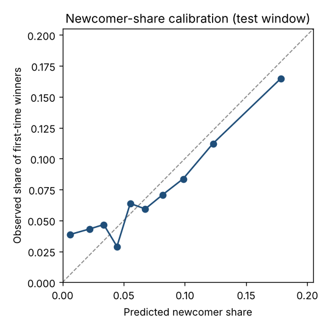

# Competitor prediction backtest

_Generated 2026-10-16T01:49:49+00:00 · mode `sample` · git `fe6a523220-dirty` · config `e4d5f2ef0ad9` · data snapshot `2026-10-16` · seed `20261015`_

## Setup

- Test window [2025-01-01, 2026-01-01): 4,914 awards with an identified winner (seeded sample of at most 5,000); 5,497 (award, winner) pairs.
- Comparables: top 100 by BM25 among awards notified before 2025-01-01; τ = 730.0 days, same-buyer boost = 0.5.
- A winner has a history when its first DECP win (full file) is before t0.

## Recall of the actual winner

| Winner group | pairs | share of pairs | Recall@5 [95 % CI] | Recall@10 [95 % CI] |
| --- | --- | --- | --- | --- |
| all | 5497 | 100.0 % | 0.156 [0.146, 0.166] | 0.203 [0.193, 0.214] |
| history, already won with this buyer | 1497 | 27.2 % | 0.361 [0.336, 0.386] | 0.441 [0.415, 0.468] |
| history, new to this buyer | 3556 | 64.7 % | 0.089 [0.080, 0.099] | 0.129 [0.118, 0.139] |
| first-time winner | 444 | 8.1 % | 0.000 [0.000, 0.000] | 0.000 [0.000, 0.000] |

First-time winners cannot be named from public history: their recall is structurally zero; the brief shows the newcomer share instead (DECISIONS, step 7).

## Newcomer-share calibration

| Predicted bucket | awards | mean predicted | observed |
| --- | --- | --- | --- |
| 0.00–0.01 | 491 | 0.006 | 0.039 |
| 0.01–0.03 | 487 | 0.022 | 0.043 |
| 0.03–0.04 | 493 | 0.034 | 0.047 |
| 0.04–0.05 | 483 | 0.044 | 0.029 |
| 0.05–0.06 | 486 | 0.055 | 0.064 |
| 0.06–0.07 | 489 | 0.068 | 0.059 |
| 0.07–0.09 | 494 | 0.082 | 0.071 |
| 0.09–0.11 | 502 | 0.099 | 0.084 |
| 0.11–0.14 | 490 | 0.123 | 0.112 |
| 0.14–0.50 | 492 | 0.178 | 0.165 |

## Caveats

- DECP records wins, not lost bids: a tender the company bid on and lost counts as irrelevant, so recall on wins is a lower bound and precision is not claimed.
- The award `objet` stands in for the original notice text (historical notices are not reliably linked to awards).
- DECP covers contracts above €40,000 excl. VAT: a company with only smaller wins looks new.
